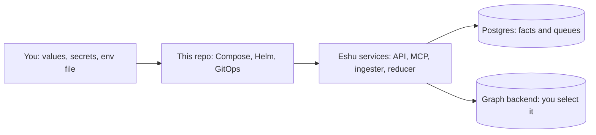

# eshu-deploy

Status: deployment assets for Eshu. You use this repo to run Eshu; the Eshu
programs themselves live in [eshu](https://github.com/eshu-hq/eshu).

Deployment assets to run Eshu locally or as a shared team service.

## What This Repo Is, And Why

Eshu is a self-hosted context graph: it links your code, dependencies, infrastructure, and runtime into one place you can query, with evidence. This repo holds the files that start it: a Helm chart (a packaged Kubernetes install), Docker Compose files (a local multi-container run), GitOps examples (cluster config kept in Git), and the guides under `docs/`.

This repo holds no Eshu application code and no secrets. Images, schema setup, and repair tools stay owned by [eshu](https://github.com/eshu-hq/eshu). Learn what Eshu does there; come back here to run it.



In words: you supply settings and secrets, these assets start the Eshu
services, and those services store facts in Postgres and linked data in the
graph backend your deployment selects.

## When To Use This Repo, And When Not To

Use this repo to run Eshu on your laptop, on Kubernetes, on Amazon EKS (managed Kubernetes on AWS), or through Argo CD.

Do not use this repo to change Eshu behavior. It does not build the Eshu programs, and it does not create your cloud account, cluster, database, or secrets. For code changes, use [eshu](https://github.com/eshu-hq/eshu).

## Choose Your Path

Pick one path first. Each path below is backed by a guide in `docs/` in this
repo.

| Path | Choose it when | Guide |
| --- | --- | --- |
| Local Compose | You want the full stack on your laptop. | [Docker Compose](docs/run-locally/docker-compose.md) |
| Kubernetes with Helm | You run Eshu as a shared team service. This is the supported Kubernetes path. | [Deploy to Kubernetes](docs/kubernetes/index.md) |
| EKS with Helm | Your shared service runs on Amazon EKS. | [Deploy To EKS](docs/eks/index.md) |
| Argo CD (GitOps) | Your cluster syncs config from Git. | [Argo CD and GitOps](docs/kubernetes/argocd.md) |
| Minimal raw manifests | You need a small example only. Not for production. | [Minimal manifests](docs/kubernetes/manifests.md) |

Paths in this repo: the chart lives at `helm/eshu`, Compose files live at
`compose/`, and GitOps examples live at `gitops/`. Some older guide pages
still show `deploy/helm/eshu`, `deploy/argocd`, or `deploy/manifests/minimal`.
In this repo, use `helm/eshu`, `gitops/argocd`, and
`gitops/manifests/minimal` instead.

## Quickstart

### Local Compose

You need Docker and a checkout of [eshu](https://github.com/eshu-hq/eshu),
because the Compose services build from its `Dockerfile`.

```bash
export ESHU_REPO_ROOT="/path/to/eshu"
docker compose -f compose/docker-compose.yaml config -q
docker compose -f compose/docker-compose.yaml up --build
```

Wait for the one-shot setup jobs to finish, then check the API:

```bash
docker compose -f compose/docker-compose.yaml ps
curl -sS http://localhost:8080/healthz
```

Success check: `ps` shows the API (`eshu`, port 8080) and MCP server (port
8081) up, and the health request returns a success response. A running
container alone does not prove indexing finished; follow the
[Docker Compose guide](docs/run-locally/docker-compose.md) for index checks.
Copy [`.env.example`](.env.example) values into your environment as needed,
and change every `change-me` password before you expose the stack.

### Kubernetes With Helm

You need `kubectl`, Helm 3, a Postgres database, and a Bolt-compatible graph
endpoint (the wire protocol both supported graph options use). The chart does
not install Postgres. Read
[Prerequisites](docs/kubernetes/prerequisites.md) and
[Storage](docs/kubernetes/storage.md) first, then create the namespace and
the secrets the chart expects:

```bash
kubectl create namespace eshu
kubectl -n eshu create secret generic eshu-api-auth \
  --from-literal=api-key="$ESHU_API_KEY"
kubectl -n eshu create secret generic eshu-postgres \
  --from-literal=dsn="$ESHU_POSTGRES_DSN"
kubectl -n eshu create secret generic eshu-neo4j \
  --from-literal=username="$GRAPH_USERNAME" \
  --from-literal=password="$GRAPH_PASSWORD"
```

Write a small `values.eshu.yaml` (see the
[Helm Quickstart](docs/kubernetes/helm-quickstart.md) for a full example),
render before you install, then install from this repo root:

```bash
helm template eshu ./helm/eshu -f values.eshu.yaml
helm upgrade --install eshu ./helm/eshu \
  --namespace eshu -f values.eshu.yaml
kubectl -n eshu get pods
kubectl -n eshu rollout status deployment/eshu-api
```

Success check: the render succeeds with no error, the schema bootstrap Job
completes, and the API rollout reports success. Pod health alone does not
prove indexing is complete; use the rollout proof steps in the
[Helm Quickstart](docs/kubernetes/helm-quickstart.md).

For EKS, follow the same Helm install with the values and secret sync steps
in [Deploy To EKS](docs/eks/index.md). For Argo CD, start from
`gitops/argocd/base/` and the overlay that fits your platform; see
[Argo CD and GitOps](docs/kubernetes/argocd.md).

## How It Works

Data in: your Helm values or Compose environment, your secrets, and the repositories you tell Eshu to index. Data out: running Eshu services (API, MCP server, ingester, and the reducer, also called the resolution engine), plus optional collectors you enable. A short-lived schema bootstrap Job sets up Postgres and the graph schema first; it runs the core image, and the schema code stays in `eshu`.

## Configuration

Set only what your path needs. Keep secrets in Kubernetes Secrets, your
secret manager, or a private env file. Never commit secret values.

| Name | Required | Default | Meaning |
| --- | --- | --- | --- |
| `image.repository` / `image.tag` (Helm values) | Yes, for Helm | `ghcr.io/eshu-hq/eshu` / `v0.0.3-pre-release-18` in `helm/eshu/values.yaml` | Core Eshu image most workloads run. Pin your own build for production. |
| `contentStore.secretName` / `contentStore.dsnKey` (Helm values) | Yes, for Helm | Set in your values file | Names the Secret and key that hold the Postgres connection string. |
| `neo4j.uri` (Helm values) | Yes, for Helm | Set in your values file | Bolt address of your graph backend. The name is historical; both graph options use this shape. |
| `ESHU_GRAPH_BACKEND` (in Helm `env`) | Yes, for Helm | Set in your values file | Selects the graph backend for your deployment. Set it with the matching database names in the quickstart example. |
| `ESHU_REPO_ROOT` | Yes, for Compose builds | `.` | Folder with the `eshu` checkout and its `Dockerfile`. In this repo, point it at that checkout. |
| `ESHU_POSTGRES_PASSWORD`, `ESHU_NEO4J_PASSWORD` | For Compose | `change-me` in `.env.example` | Local database passwords. Change them before any non-local use. |
| `ESHU_API_KEY` | For API auth | Empty in `.env.example` | Optional explicit API and MCP bearer token (secret key). |
| `ESHU_HTTP_PORT` | No | `8080` in `.env.example` | Local API port override. |

Full value-by-value help lives in [Helm Values](docs/kubernetes/helm-values.md).
Chart defaults live in [`helm/eshu/values.yaml`](helm/eshu/values.yaml) and
must match [`helm/eshu/values.schema.json`](helm/eshu/values.schema.json).

One honest note on images: separate satellite images exist (the extracted API image in `values.yaml`, and digest-pinned collector seed images for Loki, Tempo, and vulnerability intelligence). By default most workloads still run the shared core image; for example `mcpServer.image` is empty by default, so MCP uses the core image unless you set it. Render the chart before you assume a workload runs a satellite image.

## Deploy And Run

- Local: use Compose above. Other Compose files in `compose/` cover the Neo4j
  compatibility stack, local telemetry, demo, and test stacks; see the table
  in the [Docker Compose guide](docs/run-locally/docker-compose.md).
- Shared service: use Helm above, then finish the
  [Production Checklist](docs/kubernetes/production-checklist.md) before you
  expose the service.
- Upgrades and rollbacks: follow
  [Upgrades and Rollbacks](docs/kubernetes/upgrades-rollbacks.md) and
  [Rollout and Recovery](docs/rollout-recovery.md). Re-render with
  `helm template` (see Quickstart) before every upgrade.

### Eshu Dependencies

| This repo needs | It talks to | It never touches |
| --- | --- | --- |
| Eshu release images from the `eshu` repo | Your Postgres database and selected graph backend | Eshu source code; fixes to programs land in `eshu` |
| Your Kubernetes cluster or Docker host | Your secret store, by reference only | Secret values in Git; examples hold references, not credentials |
| Optional collectors you enable, with their credentials | The source systems those collectors observe | Systems for collectors you left disabled |

## Operations And Troubleshooting

- Pods are up but answers are empty: health is not the same as a finished
  index. Check the schema Job, ingester, and reducer progress in the
  [Helm Quickstart](docs/kubernetes/helm-quickstart.md).
- Render fails after a values change: run `helm template` again and fix the
  first error it names. Then run `make ci-charts` (see Development).
- Compose build cannot find the `Dockerfile`: set `ESHU_REPO_ROOT` to your
  `eshu` checkout and retry.
- Backup, restore, and recovery: use
  [Backup and Restore Proof](docs/kubernetes/backup-restore-proof.md) and
  [Rollout and Recovery](docs/rollout-recovery.md).
- Dashboards and alerts in this repo live in `grafana/` and `observability/`.

## Development

Run the same checks CI runs, before you push:

```bash
make help
make ci
```

Single-area checks: `make ci-lint` (YAML, workflow, and shell checks),
`make ci-charts` (Helm lint and render), `make ci-compose` (Compose config),
`make ci-manifests` (manifest and schema checks), and `make ci-go` (Go
contract tests). The Go version is pinned in `go.mod`. See
[CONTRIBUTING.md](CONTRIBUTING.md) for required tools and which check runs
for which change.

Layout: `helm/eshu/` (chart), `compose/` (Compose stacks and fragments),
`gitops/` (Argo CD and minimal manifests), `grafana/` and `observability/`
(dashboards, alerts, collector config), `docs/` (guides), and `scripts/`
(check and release helpers). The chart release workflow is
`.github/workflows/chart-release.yml`; it pushes the chart to
`oci://ghcr.io/<owner>/charts`.

## Docs And Related Repos

- [Run locally](docs/run-locally/index.md): Compose or local binaries.
- [Deploy to Kubernetes](docs/kubernetes/index.md): the Helm path and guides.
- [Compatibility Matrix](docs/compatibility-matrix.md): which surfaces match.
- [Seed Provenance](docs/seed-provenance.md): where this repo's files came from.
- [eshu](https://github.com/eshu-hq/eshu): the Eshu programs and product docs.
  Its [documentation index](https://github.com/eshu-hq/eshu/blob/main/docs/public/index.md)
  is the entry point for using Eshu once it runs.

## Contributing, Security, And License

- [Contributing](CONTRIBUTING.md): local checks and review rules.
- [Security policy](SECURITY.md): how to report a vulnerability. Please do
  not open a public issue for security problems.
- License: this repo has no top-level `LICENSE` file. The Helm chart metadata
  in `helm/eshu/Chart.yaml` lists `MIT` for the chart. Check that file before
  you reuse chart content.
