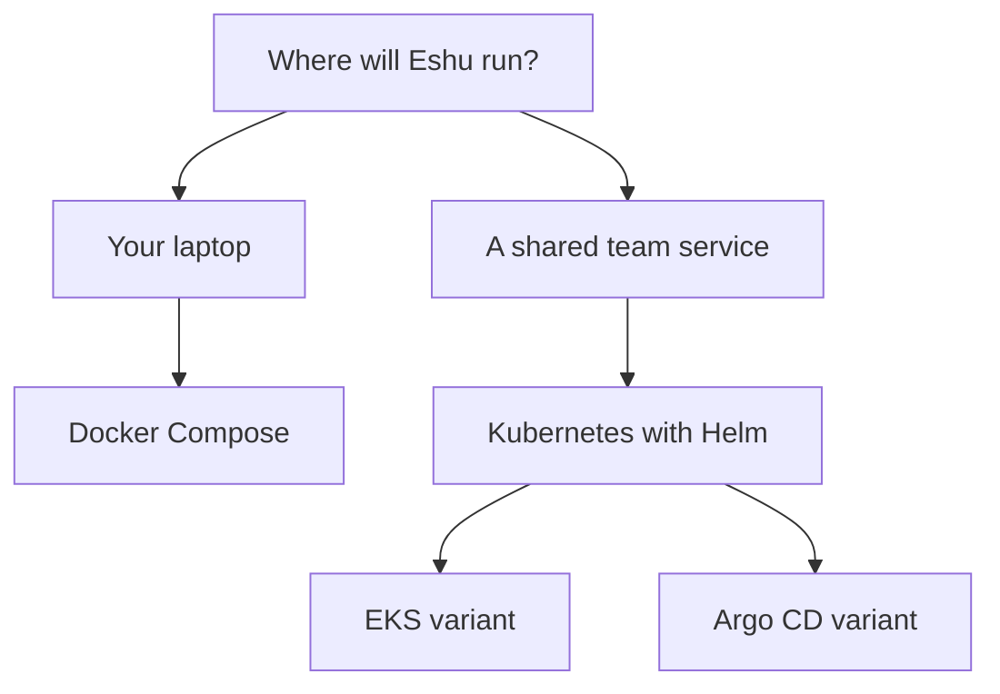

# eshu-deploy

Status: deployment assets for Eshu. You use this repo to run Eshu. The Eshu
programs themselves live in [eshu](https://github.com/eshu-hq/eshu).

Eshu links your code, dependencies, infrastructure, and runtime into one
graph you can query, with evidence. This repo holds the files that start it:
a Helm chart for Kubernetes, Compose files for your laptop, GitOps examples,
and the guides in `docs/`. There's no Eshu application code here, and no
secrets. Images and schema setup stay owned by `eshu`. Learn what Eshu does
there. Come back here to run it.

## Pick your path



In words: run Compose if Eshu lives on your laptop. Run Helm if your team
shares it. EKS and Argo CD are Helm with different wrapping, so start from
the Helm guide either way. The chart lives at `helm/eshu`, Compose files at
`compose/`, and GitOps examples at `gitops/`.

## When to use this repo, and when not to

Use this repo to run Eshu on your laptop, on Kubernetes, on Amazon EKS, or
through Argo CD. Don't use it to change how Eshu behaves. It won't build the
Eshu programs for you, and it won't create your cloud account, cluster,
database, or secrets. For code changes, head to
[eshu](https://github.com/eshu-hq/eshu) instead.

## Quickstart

On your laptop, you need Docker and a checkout of `eshu`, because Compose
builds from its `Dockerfile`:

```bash
export ESHU_REPO_ROOT="/path/to/eshu"
docker compose -f compose/docker-compose.yaml up --build
curl -sS http://localhost:8080/healthz
```

You're up when the API on port 8080 and the MCP server on port 8081 answer.
Copy what you need from [`.env.example`](.env.example), and change every
`change-me` password before you expose the stack. The
[Docker Compose guide](docs/run-locally/docker-compose.md) takes you the
rest of the way, including how to tell whether indexing finished.

For a shared service, read [Prerequisites](docs/kubernetes/prerequisites.md)
and [Storage](docs/kubernetes/storage.md) first. You'll need a Postgres
database and a graph backend ready, because the chart installs neither for
you. Then follow the [Helm Quickstart](docs/kubernetes/helm-quickstart.md).
It covers the secrets and values you'll write. Render before you install:

```bash
helm template eshu ./helm/eshu -f values.eshu.yaml
helm upgrade --install eshu ./helm/eshu --namespace eshu -f values.eshu.yaml
```

You're up when the render is clean, the schema Job completes, and the API
rollout succeeds. On EKS, use the same install with the steps in
[Deploy To EKS](docs/eks/index.md). With Argo CD, start from
`gitops/argocd/base/` and read [Argo CD and GitOps](docs/kubernetes/argocd.md).

## How it works, in short

You supply settings and secrets. These assets start the Eshu services. A
setup job prepares the databases, the ingester stores facts in Postgres, and
the reducer links them into your graph backend. You read it back through the
API and MCP server. [Concepts](docs/concepts/README.md) explains both the
Compose and Kubernetes shapes in plain words,
[Diagrams](docs/diagrams/README.md) draws them, and
[Guides](docs/guides/README.md) covers day-to-day running.

## Documentation

| You want to | Read |
| --- | --- |
| Browse everything | [Documentation index](docs/README.md) |
| Get running, shortest path | [Getting started](docs/getting-started/README.md) |
| Understand what runs where | [Concepts](docs/concepts/README.md) and [Diagrams](docs/diagrams/README.md) |
| Operate, upgrade, or recover | [Guides](docs/guides/README.md) |
| Look up versions and settings | [Reference](docs/reference/README.md) |
| Run Eshu on your laptop | [Run locally](docs/run-locally/index.md) |
| Run the full local stack | [Docker Compose](docs/run-locally/docker-compose.md) |
| Run a shared Kubernetes service | [Deploy to Kubernetes](docs/kubernetes/index.md) |
| Install with Helm, step by step | [Helm Quickstart](docs/kubernetes/helm-quickstart.md) |
| Run on Amazon EKS | [Deploy To EKS](docs/eks/index.md) |
| Sync from Git with Argo CD | [Argo CD and GitOps](docs/kubernetes/argocd.md) |
| See a tiny manifest example only | [Minimal manifests](docs/kubernetes/manifests.md) |
| Check tested version pairs | [Compatibility Matrix](docs/compatibility-matrix.md) |
| See where these files came from | [Seed Provenance](docs/seed-provenance.md) |

Once Eshu is running, its own
[documentation index](https://github.com/eshu-hq/eshu/blob/main/docs/public/index.md)
is your next stop.

## Contributing, security, and license

See [CONTRIBUTING.md](CONTRIBUTING.md) for local checks. Run `make ci`
before you push. Please use the [Security policy](SECURITY.md) for
vulnerabilities, not a public issue. This repo has no top-level `LICENSE`
file. The chart metadata in `helm/eshu/Chart.yaml` lists `MIT` for the chart,
so check that file before you reuse chart content.
