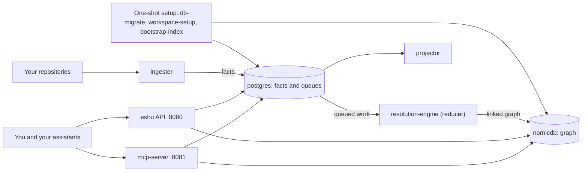
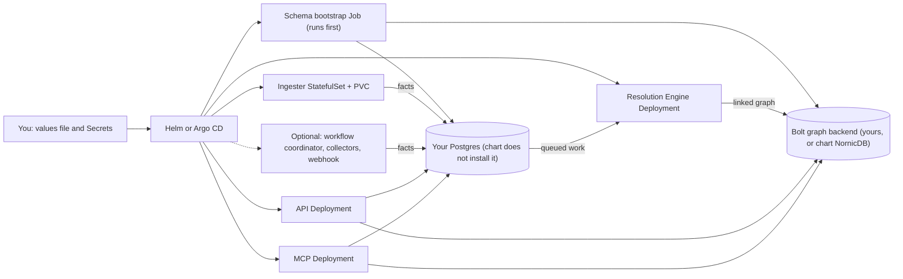

# Diagrams

These are the two deployment shapes this repo can start for you. Same Eshu,
different wrapping. If you want the ideas in plain words first, read
[Concepts](../concepts/README.md). If you want to run one, start at
[Getting started](../getting-started/README.md).

## On your laptop with Compose

*Figure 1: the default Compose stack in `compose/docker-compose.yaml`.*

In words: the one-shot jobs prepare Postgres and the graph, then the ingester
keeps feeding facts into Postgres while the reducer links them into NornicDB.
You query the API on port 8080 or the MCP server on port 8081. The projector
runs alongside and drains source-local projection work the first pass left
behind.

## As a shared service with Helm

*Figure 2: the Helm chart in `helm/eshu`, rendering separate workloads.*

In words: Helm runs the schema bootstrap Job first, then rolls out the API,
MCP server, ingester, and resolution engine as separate workloads. Postgres
is yours to provide, because the chart doesn't install it. The graph backend
is usually an endpoint you point at, though the chart can run NornicDB for you
if you ask it to.

## Related diagrams

- The EKS target shape is drawn in [Deploy To EKS](../eks/index.md).
- The "pick your path" choice is drawn in the [repo README](../../README.md).
- Why the shapes look like this: [Architecture](../architecture/README.md).
